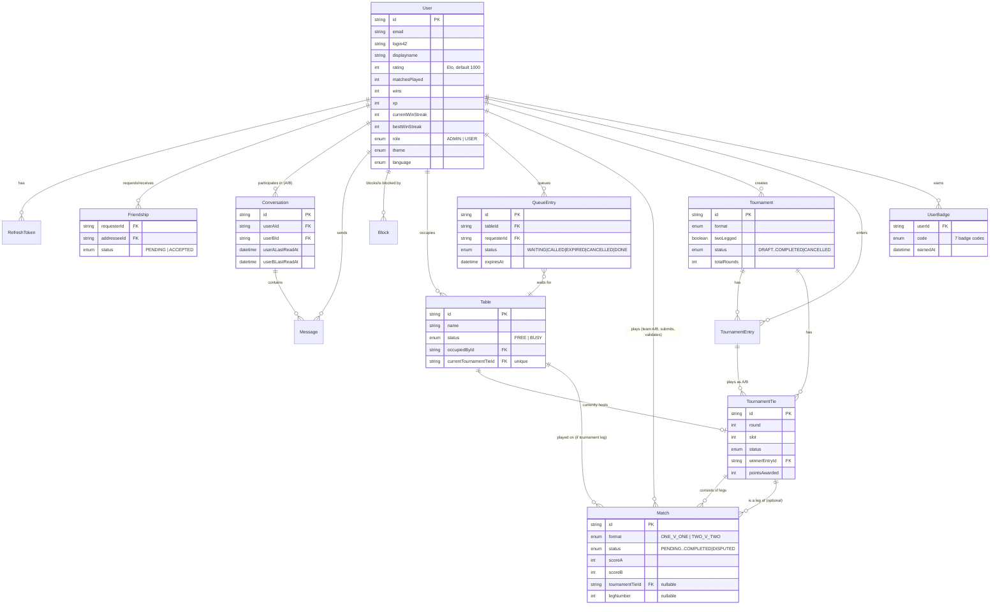

*This project has been created as part of the 42 curriculum by demane, rdinis, rbourdon, vicli, bbouarab.*

# ft_transcendence

## Description

**ft_transcendence** is a companion web app for the **2 physical babyfoot (table football) tables at 42 Paris** — deliberately **not** a Pong game. The babyfoot tables themselves are physical and unconnected; this app is the digital layer that organizes them: see if a table is free, queue for one, challenge other players from a ranking, run tournaments with automatic table assignment, and track progress with an Elo rating, XP and unlockable badges.

It is a full-stack, containerized single-page application (React front + NestJS API + PostgreSQL), built against the 42 common core subject and a chosen set of modules targeting 100%–125%.

### Key features

- **Account & security** — email/password registration, 42 intra OAuth2 login, JWT access/refresh tokens (rotated, hashed at rest), TOTP two-factor authentication.
- **Profile & social** — avatar upload, friends (request/accept/remove), online presence synced across tabs and friends, live chat (with blocking, unread counts, typing indicators, read receipts, profile access from the chat header).
- **Tables & queue** — live free/busy status for both babyfoot tables, FIFO queue with a 2-minute call window per table.
- **Ranking & matches** — challenge any player 1v1 or 2v2 directly from the ranking, score submission validated by the opponent, server-computed Elo rating.
- **Tournaments** — admin-created single-elimination brackets (1v1/2v2, single or two-legged), random draw, fully automatic table assignment as matches complete, fixed per-round bonus points.
- **Gamification** — XP and levels independent from Elo, 7 unlockable badges, all with real-time notifications.
- **Internationalization & theming** — English, French, Spanish; light/dark/system theme, both persisted per user.
- **Custom design system** — a documented, reusable component library (see [`docs/DESIGN_SYSTEM.md`](docs/DESIGN_SYSTEM.md)).

We do not claim the subject's Gaming modules (the Pong game itself, remote players, the subject's own tournament/matchmaking, spectator mode, game customization, AI opponent, 3D, etc.): the babyfoot tables are physical, this app only organizes them around that reality. Our "Elo ranking" and "Tournaments" are product features for that organization, not the subject's Game/Tournament modules.

## Instructions

### Prerequisites

- Docker and Docker Compose (v2, the `docker compose` CLI plugin).
- A [42 intra OAuth application](https://profile.intra.42.fr/oauth/applications) if you want to test 42 login (email/password login works without it).

### Setup & run (production-like, HTTPS)

```bash
git clone <this-repository>
cd ft_transcendence
cp .env.example .env
./scripts/setup-docker.sh   # generates Docker secrets: DB password, JWT secrets, 42 OAuth client secret
docker compose up --build
```

The app is served entirely over HTTPS at **https://localhost:8443** (nginx, self-signed certificate generated automatically on first boot — accept the browser warning). Plain HTTP (port 8080) redirects to HTTPS. The API is reachable at `/api`, WebSockets at `wss://localhost:8443/api/socket.io`. The backend container is not exposed directly on the host; only nginx is.

Seeded accounts (created on first boot, password `Test1234!`): `admin@ft.local` (ADMIN role), `alice@ft.local`, `bob@ft.local`.

### Development (hot reload)

```bash
docker compose -f docker-compose.dev.yml up --build
```

Frontend on `http://localhost:5173` (Vite, hot reload), backend on `http://localhost:5000` (NestJS, watch mode), no TLS.

### Configuration

All configuration lives in `.env` (copied from `.env.example`), documented inline: ports, `PUBLIC_URL`, JWT expiration times, and 42 OAuth `CLIENT_ID`/`REDIRECT_URI` (the client secret itself is a Docker secret, generated by `./scripts/setup-docker.sh`, never committed). To test 42 OAuth login, create an app at [profile.intra.42.fr/oauth/applications](https://profile.intra.42.fr/oauth/applications) and register both redirect URIs:

- Dev: `http://localhost:5000/auth/42/callback`
- Production: `https://localhost:8443/api/auth/42/callback`

Emails (GDPR export and account-deletion confirmations) are sent through SMTP (`SMTP_HOST`, `SMTP_PORT`, `MAIL_FROM`). By default they go to the bundled **Mailpit** test inbox, readable at [http://localhost:8025](http://localhost:8025); point the `SMTP_*` variables to a real server to send real emails.

**Troubleshooting** — if the backend loops on `P1001: Can't reach database server at db:5432`, an old container lost its Docker network (typical after switching between the dev and production stacks). Run `docker compose down` (never `-v`, which deletes the data) and start again, or `docker compose up -d --force-recreate db`; the data lives in a named volume and is kept.

### Further documentation

- [`docs/PLAN.md`](docs/PLAN.md) — product scope, business rules, data model, module checklist.
- [`docs/team/`](docs/team/) — one document per team member, covering the whole project's implementation between them, down to the code: [`demane.md`](docs/team/demane.md) (technical foundation: auth, users, presence, chat, i18n/theming, infra, design system), [`rdinis.md`](docs/team/rdinis.md) (Tables & Queue), [`rbourdon.md`](docs/team/rbourdon.md) (Match & Elo), [`vicli.md`](docs/team/vicli.md) (Tournaments), [`bbouarab.md`](docs/team/bbouarab.md) (Gamification).
- [`docs/DESIGN_SYSTEM.md`](docs/DESIGN_SYSTEM.md) — palette, typography, icons, component library.
- [`docs/HTTPS.md`](docs/HTTPS.md) — TLS / reverse-proxy setup. [`docs/PRESENCE.md`](docs/PRESENCE.md) — online presence design.

## Resources

Official documentation and references used throughout the project:

- [NestJS documentation](https://docs.nestjs.com/) — backend framework, modules, guards, WebSocket gateways.
- [Prisma documentation](https://www.prisma.io/docs) — schema, migrations, client.
- [React documentation](https://react.dev/) and [React Router](https://reactrouter.com/) — frontend framework and routing.
- [Redux Toolkit / RTK Query documentation](https://redux-toolkit.js.org/) — state management and data fetching/caching.
- [Socket.IO documentation](https://socket.io/docs/v4/) — real-time WebSocket communication.
- [Tailwind CSS documentation](https://tailwindcss.com/docs) — utility-first styling.
- [Base UI documentation](https://base-ui.com/) — headless, accessible component primitives.
- [42 API / OAuth documentation](https://api.intra.42.fr/apidoc) — 42 intra OAuth2 login.
- [RFC 6238 (TOTP)](https://datatracker.ietf.org/doc/html/rfc6238) — time-based one-time password algorithm behind the 2FA implementation.
- [Elo rating system (Wikipedia)](https://en.wikipedia.org/wiki/Elo_rating_system) — reference for the ranking formula (expected score, K-factor).
- [PostgreSQL documentation](https://www.postgresql.org/docs/) and [nginx documentation](https://nginx.org/en/docs/) — database and reverse proxy.

### How AI was used

**Claude (Anthropic)** was used as a pair-programming assistant throughout the project, under the direction and review of the Tech Lead (`demane`), across essentially every part of the codebase built so far:

- **Backend** — scaffolding and implementing NestJS modules (auth/JWT/2FA/OAuth, users/friends, presence, chat, tables, queue, matches/Elo, tournaments, gamification), designing the Prisma schema and hand-writing SQL migrations, and working through concurrency edge cases (e.g. atomic table-claim updates to avoid race conditions).
- **Frontend** — building React pages and components, Redux Toolkit/RTK Query slices, WebSocket integration, i18n translations (EN/FR/ES), and the design system.
- **Debugging & testing** — diagnosing bugs (e.g. a matches-played double-counting bug across two modules, a 2v2 teammate-selection bug), and writing throwaway Playwright/API test scripts used during development to verify features end-to-end (these scripts are not part of the shipped codebase).
- **Documentation** — drafting and maintaining `docs/PLAN.md`, `docs/team/*.md`, `docs/DESIGN_SYSTEM.md`, and this README.

All AI-assisted code was reviewed, tested, and is understood by the Tech Lead before being considered part of the project; per-feature implementation detail (so any team member can explain any part at the defense) is written up in [`docs/team/`](docs/team/), one file per member (see Team Information below).

## Team Information

| Login | Role(s) | Responsibilities |
| --- | --- | --- |
| `demane` | Tech Lead | Owns the technical foundation (authentication, user management, presence, chat, i18n, theming, Docker/HTTPS/infra) and, at this stage, the full product feature set described below. Reviews and merges teammates' feature slices, keeps the architecture consistent, and coordinates AI-assisted implementation (see "How AI was used" above). Documented in [`docs/team/demane.md`](docs/team/demane.md). |
| `rdinis` | Developer | Assigned to own the **Tables & Queue** feature slice end-to-end (Prisma model → NestJS route → React page), reviewed by the Tech Lead before merge. Documented in [`docs/team/rdinis.md`](docs/team/rdinis.md). |
| `rbourdon` | Developer | Assigned to own the **Match & Elo** feature slice. Documented in [`docs/team/rbourdon.md`](docs/team/rbourdon.md). |
| `vicli` | Developer | Assigned to own the **Tournaments** feature slice. Documented in [`docs/team/vicli.md`](docs/team/vicli.md). |
| `bbouarab` | Developer | Assigned to own the **Gamification (XP & badges)** feature slice. Documented in [`docs/team/bbouarab.md`](docs/team/bbouarab.md). |

Every member is expected to be able to explain the whole project at the defense, not just their own slice — the 5 files in [`docs/team/`](docs/team/) together cover the entire implementation.

## Project Management

- **Task distribution** — one product feature = one owner, taken as a complete vertical slice (database model → backend route → frontend page) rather than split horizontally by layer. The Tech Lead pairs briefly with each feature owner at the start of their slice, then reviews the resulting pull request.
- **Tools** — no dedicated ticket tracker; the team works from the running checklist in [`docs/PLAN.md`](docs/PLAN.md) (business rules, data model, and a per-feature status table), kept up to date as work progresses.
- **Communication** — Discord, used for day-to-day coordination and informal syncs rather than scheduled meetings.

## Technical Stack

### Frontend

- **React 19** + **TypeScript**, built with **Vite**.
- **Redux Toolkit** with **RTK Query** for state management, data fetching and caching (one API slice per backend domain, cache invalidated/patched live from WebSocket events).
- **React Router** for client-side routing.
- **Tailwind CSS v4** + **Base UI** (headless, accessible component primitives) for styling — chosen for utility-first speed of iteration and built-in accessibility (focus management, ARIA) without hand-rolling it.
- **Socket.IO client** for real-time features.
- **i18next** for internationalization (English/French/Spanish).

### Backend

- **NestJS** + **TypeScript** — chosen for its opinionated, modular architecture (one module per domain) that maps cleanly onto "one feature = one team member".
- **Prisma ORM** over **PostgreSQL** — Prisma for type-safe queries and migrations generated from a single schema file; PostgreSQL for its maturity, strong relational/transactional guarantees (needed for things like atomic table-claiming and tournament bracket transitions), and native support for the partial unique indexes used to enforce a few business rules (one busy table per user, one active queue entry per user).
- **Socket.IO** (server side) — one namespace per domain, each authenticated via the same JWT-in-handshake pattern.
- **Passport** — JWT strategies (access/refresh/pre-auth) and the 42 OAuth2 strategy.
- **bcrypt** for password hashing, **otplib** for TOTP 2FA.
- **class-validator** (backend) and **Zod** (frontend) for request/form validation on both ends.

### Infrastructure

- **Docker Compose** — one command to run the whole stack (`docker compose up`), a separate `docker-compose.dev.yml` for hot-reload development.
- **nginx** — TLS termination and reverse proxy in production, serving the static frontend build, `/api` and `/api/socket.io` from a single HTTPS origin, with a self-signed certificate generated on first boot.
- **Docker secrets** for all credentials (DB password, JWT secrets, OAuth client secret) — never stored as plain environment variables.

## Database Schema

Full source of truth: [`backend/prisma/schema.prisma`](backend/prisma/schema.prisma). Simplified entity-relationship overview:



Two business rules are enforced with hand-written partial unique indexes rather than plain Prisma DSL (kept as raw SQL in their migrations): a user can only occupy one `Table` at a time, and can only hold one active `QueueEntry` at a time.

## Features List

| Feature | Description | Implemented by (current) | Assigned owner / doc |
| --- | --- | --- | --- |
| Auth (email/password, 42 OAuth, JWT, 2FA) | Registration/login, 42 intra OAuth2, rotating hashed refresh tokens, TOTP 2FA with a pending-then-active activation flow | `demane` | [`docs/team/demane.md`](docs/team/demane.md) |
| User profile, avatar, friends | Editable profile, avatar upload, friend requests/accept/remove | `demane` | [`docs/team/demane.md`](docs/team/demane.md) |
| Online presence | Multi-tab-aware online/offline status, synced live to friends | `demane` | [`docs/team/demane.md`](docs/team/demane.md) |
| Live chat | 1:1 conversations between friends, blocking, unread counts, typing indicators, read receipts, profile link from the chat header | `demane` | [`docs/team/demane.md`](docs/team/demane.md) |
| i18n & theming | English/French/Spanish, light/dark/system theme, 8 main colors (green by default) and 3 corner styles (square by default, rounded, very rounded), all persisted per user in the database and applied on every page | `demane` | [`docs/team/demane.md`](docs/team/demane.md) |
| Design system | Documented palette, typography, icon set and 16 reusable components | `demane` | [`docs/team/demane.md`](docs/team/demane.md) / [`docs/DESIGN_SYSTEM.md`](docs/DESIGN_SYSTEM.md) |
| Tables | Live free/busy status for both babyfoot tables, atomic occupy/release | `demane` | `rdinis` — [`docs/team/rdinis.md`](docs/team/rdinis.md) |
| Queue | FIFO waiting list per table, 2-minute call window, automatic advance | `demane` | `rdinis` — [`docs/team/rdinis.md`](docs/team/rdinis.md) |
| Match & Elo | Challenge from the ranking (1v1/2v2), opponent-validated score, server-computed Elo | `demane` | `rbourdon` — [`docs/team/rbourdon.md`](docs/team/rbourdon.md) |
| Tournaments | Admin-created single-elimination bracket, random draw, automatic table assignment, fixed per-round points, two-legged option, one running tournament at a time (others wait in a queue and start automatically) | `demane` | `vicli` — [`docs/team/vicli.md`](docs/team/vicli.md) |
| GDPR (data export & account deletion) | Download your data as CSV or JSON, delete (anonymise) your account after an emailed confirmation link, confirmation emails | `demane` | — |
| Health check & backups | Public status page, `/health` endpoint, Docker healthchecks, scheduled PostgreSQL dumps with retention, restore script | `demane` | [`docs/BACKUP.md`](docs/BACKUP.md) |
| Search & filters | Filters, sorting and pagination on the History and Ranking pages | `demane` | — |
| Gamification (XP & badges) | XP/levels independent from Elo, 7 unlockable badges, real-time unlock notifications | `demane` | `bbouarab` — [`docs/team/bbouarab.md`](docs/team/bbouarab.md) |

"Implemented by" reflects the actual git history to date (see Individual Contributions). "Assigned owner" is who is taking that slice's documentation and presentation ownership going forward — each has their own file in [`docs/team/`](docs/team/) written for that purpose.

## Modules

Target: **125%** = 14 required points + up to 5 bonus points. Major = 2 pts, Minor = 1 pt.

### Required modules (14 pts / 100%)

| Module | Type | Pts | Justification / how it was implemented |
| --- | --- | --- | --- |
| Frameworks — React (front) + NestJS (back) | Major | 2 | Whole app; see Technical Stack. |
| ORM — Prisma | Minor | 1 | Single `schema.prisma`, generated client, hand-written migrations for constraints Prisma DSL can't express. |
| User management (profile, avatar, friends, presence) | Major | 2 | See "User profile, avatar, friends" and "Online presence" in Features List. |
| Standard user management — OAuth 2.0 (42 intra) | Minor | 1 | `passport-42` strategy, account creation/lookup by `login42`; see section 1.3 of [`docs/team/demane.md`](docs/team/demane.md). |
| Two-factor authentication (TOTP) + JWT | Minor | 1 | `otplib`-based TOTP with a pending→active activation flow; JWT access/refresh/pre-auth tokens, refresh tokens hashed at rest and rotated. |
| Multiple language support | Minor | 1 | `i18next`, English/French/Spanish, persisted per user. |
| Remote authentication / real-time features — WebSockets | Major | 2 | One authenticated Socket.IO namespace per domain (presence, chat, tables, queue, matches, tournaments, badges) — see section 8 of [`docs/team/demane.md`](docs/team/demane.md). |
| Live chat | Major | 2 | Conversations, blocking, unread state, real-time delivery — see "Live chat" in Features List. |
| Notification system (CUD) | Minor | 1 | Toasts + live UI updates for chat, friend requests, queue calls, match results, tournament progress — all pushed via the WebSocket gateways above. |
| Gamification | Minor | 1 | Elo ranking as leaderboard, plus tournament points and the XP/badge system — see [`docs/team/bbouarab.md`](docs/team/bbouarab.md). |

### Bonus modules implemented (+5 pts: the maximum)

| Module | Type | Pts | Justification / how it was implemented |
| --- | --- | --- | --- |
| Advanced chat | Minor | 1 | Profile link from the chat header, typing indicators (debounced WebSocket event), real-time read receipts (single/double check derived from existing per-conversation last-read timestamps, pushed live). **Invite to play from the chat**: a Challenge button in the conversation header opens the same 1v1/2v2 challenge dialog as the ranking (the opponent gets the usual match notification), next to an "Invite to play chess" button reserved for the chess game being integrated. |
| Custom design system | Minor | 1 | Documented palette (light/dark tokens), single monospace typeface, `lucide-react` icon set, and 16 reusable components (well above the 10 required) — see [`docs/DESIGN_SYSTEM.md`](docs/DESIGN_SYSTEM.md) for the full list, variants and usage. |
| Health check, status page, automated backups & disaster recovery | Minor | 1 | Public `GET /health` (real DB query + latency, backup freshness, 503 when the DB is down), public `/status` page refreshed every 15 s, Docker healthchecks on db/backend/frontend, a `backup` service dumping PostgreSQL every 24 h with 7-day retention, and a transactional restore script — see [`docs/BACKUP.md`](docs/BACKUP.md). |
| Advanced search | Minor | 1 | Server-side search, filters, sorting and pagination (validated by DTOs, debounced filter bars) on two lists. **Match history** (`GET /matches/me/history`): player name, result (win/loss), format (1v1/2v2), origin (ladder/tournament), sort by date or score gap. **Ranking** (`GET /users/ranking`): player name, scope (everyone / me and my friends), minimum matches played, sort by rank, matches or name; the displayed rank always stays the overall rank, whatever the filter. Friends lists also filter by name and online status. |
| GDPR compliance | Minor | 1 | **Data request/export**: `GET /gdpr/export?format=csv|json` returns everything we hold (profile, friends, matches, badges, notifications, sent messages…) as a CSV (one file, one section per data type, opens in Excel/LibreOffice, formula-injection safe) or an indented JSON, never secrets such as the password hash or 2FA secret; the UI asks for the format, then downloads. **Deletion with confirmation and anonymisation**: `POST /gdpr/deletion-request` emails a signed one-hour link (own signing key, single purpose), and `POST /gdpr/deletion-confirm` erases the personal data (email, name, avatar, credentials, friends, conversations, badges, notifications, unfinished challenges, sessions) and keeps the user row under the name "Deleted user", so finished matches, Elo and tournaments of the other players stay intact; the account can no longer sign in, appear in searches or in the ranking. Refused while the user has an open tournament or is playing on a table. **Confirmation emails** (nodemailer/SMTP, Mailpit in Docker for testing) for the export, the deletion request and the deletion, in the user's language. UI: Settings → Privacy & data, plus the `/confirm-deletion` page. The Privacy Policy describes these rights. |

### Bonus modules planned, not yet implemented

PWA (installable, offline table-status view) and cross-browser testing (Firefox/Safari) — kept as fallbacks in case a claimed module is not validated; see [`docs/PLAN.md`](docs/PLAN.md).

**Custom "modules of choice" note**: our Elo ranking and Tournament system are *product features*, not the subject's Gaming "Tournament"/"Game stats" modules — they organize the 2 physical babyfoot tables rather than a Pong match, and are declared as such (see the "Description" and [`docs/PLAN.md`](docs/PLAN.md) for the full boundary).

## Individual Contributions

At this stage in the project, `demane` (Tech Lead) has implemented the technical foundation and all product features listed above, with AI-assisted pair programming (Claude — see "How AI was used") reviewed and validated feature by feature; this is reflected honestly rather than split up artificially. `rdinis`, `rbourdon`, `vicli` and `bbouarab` (Developers) are each assigned one of the five product feature slices (Tables & Queue, Match & Elo, Tournaments, Gamification respectively) to take over, extend/refactor as needed, and be ready to present in depth at the defense — their code has not been pushed yet. Each has their own write-up of their assigned slice in [`docs/team/`](docs/team/) to work from.

### Challenges faced (and how they were overcome)

- **Race conditions on shared resources** — two players occupying the same table, or joining the same queue slot, at the same instant. Solved with guarded `updateMany` calls (`WHERE status = ...`) that check the affected row count instead of a read-then-write, so a losing request gets a clean rejection instead of corrupting state.
- **Circular module dependencies** — Tables, Queue, Matches, Tournaments and Badges all need to call into each other (e.g. a tournament match completing must free a table, advance a queue, and award a badge). Resolved with one-directional dependency design (`Tournaments → {Tables, Queue, Badges}`, `Matches → {Tournaments, Badges}`) plus NestJS `forwardRef()` where a genuine cycle was unavoidable.
- **Double-counting a stats counter** — `matchesPlayed` was incremented both by the original Elo code path and, later, by the new gamification module, silently doubling it. Fixed by making the gamification module the single owner of that counter.
- **2v2 teammate selection bug** — a challenged player's only friend could be proposed as their own teammate even when that friend was the opponent, and both sides could pick teammates that overlapped with the opponent's team. Fixed with explicit exclusion checks on both the challenge and the response step, backend and frontend.
- **Tournament table scheduling** — making two tables independently pick up whichever tournament matches are ready, in random order, without double-booking a table or leaving a ready match waiting when a table is free, implemented as a small scheduler (`scheduleFreeTables`) run after every relevant state change (launch, leg completed, table freed).

## License

School project (42 curriculum) — no license granted for reuse outside of academic evaluation.
