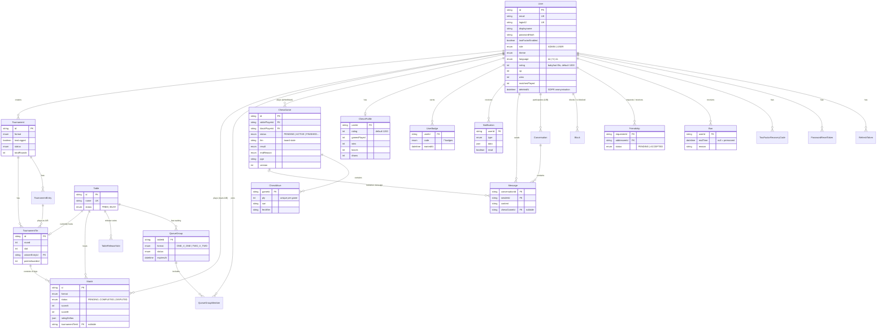

*This project has been created as part of the 42 curriculum by demane, rdinis, rbourdon, vicli, bbouarab.*

# ft_transcendence

## Description

**ft_transcendence** is a multiplayer web platform built around **online 3D chess** and the **two physical babyfoot (table football) tables of 42 Paris**.

- **Chess side** — challenge a friend (from the lobby or directly from the chat) or play against an AI with four difficulty levels, on a real-time 3D board, with rules enforced by the server.
- **Babyfoot side** — the tables themselves are physical and not connected to anything; the app is the digital layer that organizes them: see whether a table is free, queue for it, challenge players 1v1 or 2v2 from the ranking, run tournaments with automatic table assignment, and follow an Elo rating.
- **Social layer** — accounts, friends, live chat, notifications, XP/levels and badges, administration and moderation tools.

It is a full-stack, containerized single-page application: **React 19** (front) + **NestJS 11** (API) + **PostgreSQL** through **Prisma**, served over HTTPS by nginx.

### Key features

- **Accounts & security** — email/password registration, 42 intra OAuth 2.0 login, password reset by email, rotating hashed refresh tokens, TOTP two-factor authentication with recovery codes.
- **Profile & social** — editable profile, avatar upload, friends (request/accept/remove), online presence synced across tabs and friends, private real-time chat (blocking, unread counts, typing indicators, read receipts).
- **Chess** — complete rules (check, mate, stalemate, repetition, insufficient material, resignation), server-authoritative moves, 3D board (Three.js), AI opponent (4 levels), game history, challenge invitations from the chat.
- **Babyfoot tables & queue** — live free/busy status of both tables, FIFO queue with a call window.
- **Ranking, matches & tournaments** — 1v1/2v2 challenges with opponent-validated score and server-computed Elo, single-elimination tournaments with random draw and automatic table assignment.
- **Gamification** — XP and levels, 7 unlockable badges, live unlock notifications.
- **Administration** — user CRUD, roles, bans (temporary or permanent), table and tournament management.
- **Internationalization & theming** — English, French, Spanish; light/dark/system theme, accent colour and corner style, all persisted per user.
- **Operations** — public status page and `/health` endpoint, automated PostgreSQL backups with restore script, GDPR data export and account deletion.

## Instructions

### Prerequisites

- **Docker** and **Docker Compose v2** (the `docker compose` plugin), plus **make**.
- **Google Chrome** (latest stable) to browse the app.
- *Optional* — a [42 intra OAuth application](https://profile.intra.42.fr/oauth/applications) to test "Sign in with 42" (email/password login works without it).

Nothing else needs to be installed on the host: Node, PostgreSQL and nginx all run in containers.

### Run the project (production-like, HTTPS)

```bash
git clone <this-repository>
cd ft_transcendence
make setup   # creates .env.dev / .env.prod from .env.example and generates the Docker secrets
make prod    # builds and starts the whole stack
```

The app is then served over HTTPS at **https://localhost:8443**. nginx generates a self-signed certificate on first boot, so accept the browser warning once. Plain HTTP (port 8080) redirects to HTTPS. The API lives under `/api` and WebSockets under `wss://localhost:8443/api/socket.io`; the backend container is not exposed on the host, only nginx is.

`make` (or `make help`) lists every available command (logs, shell, database backup/restore, …).

### Development (hot reload)

```bash
make setup   # once
make dev
```

Frontend on `http://localhost:5173` (Vite), backend on `http://localhost:5000` (NestJS watch mode), no TLS.

### Environment & secrets

- `make setup` copies [`.env.example`](.env.example) to `.env.dev` and `.env.prod` (both ignored by Git) and generates random Docker secrets in `secrets/` (database password, JWT secrets, 42 client-secret placeholders). Nothing sensitive is committed.
- Settings you may want to edit in `.env.prod` / `.env.dev`: ports, `PUBLIC_URL`, JWT lifetimes, SMTP, backup interval/retention, and the 42 `CLIENT_ID`.
- **42 OAuth** (optional): create an application on the 42 intra, put its `CLIENT_ID` in the `.env.*` file and its secret in `secrets/client_secret` (prod) / `secrets/client_secret.dev` (dev), and register both redirect URIs:
  - Production: `https://localhost:8443/api/auth/42/callback`
  - Development: `http://localhost:5000/auth/42/callback`
- **Emails** (password reset, GDPR confirmations, ban notice) go by default to the bundled **Mailpit** test inbox at [http://localhost:8025](http://localhost:8025). Point `SMTP_HOST`/`SMTP_PORT` to a real server to send real emails.

### Demo accounts

Created at every start (password **`Test1234!`**): `admin@ft.local` (role `ADMIN`) and regular users such as `lucas.moreau@ft.local` or `emma.lefebvre@ft.local` (pattern `firstname.lastname@ft.local`), with friendships, matches and badges already in place so every page has content. Use two browser profiles to try the multi-user features (chat, chess, challenges).

### Troubleshooting

If the backend loops on `P1001: Can't reach database server at db:5432`, an old container lost its Docker network (typical after switching between the dev and prod stacks). Run `docker compose down` (never with `-v`, which deletes the data) and start again. The data lives in a named volume and is kept.

## Resources

### References

- [NestJS](https://docs.nestjs.com/) — backend framework, modules, guards, WebSocket gateways.
- [Prisma](https://www.prisma.io/docs) — schema, migrations, client.
- [React](https://react.dev/) and [React Router](https://reactrouter.com/) — frontend framework and routing.
- [Redux Toolkit / RTK Query](https://redux-toolkit.js.org/) — state management and API caching.
- [TanStack Form](https://tanstack.com/form/latest) and [Zod](https://zod.dev/) — form handling and validation.
- [Socket.IO](https://socket.io/docs/v4/) — real-time communication.
- [Tailwind CSS](https://tailwindcss.com/docs) and [Base UI](https://base-ui.com/) — styling and accessible headless components.
- [Three.js](https://threejs.org/docs/) — 3D rendering of the chessboard.
- [chess.js](https://github.com/jhlywa/chess.js) — move generation and rules validation.
- [Chess Programming Wiki](https://www.chessprogramming.org/) — negamax, alpha-beta pruning, quiescence search, piece-square tables.
- [i18next](https://www.i18next.com/) — internationalization.
- [42 API / OAuth](https://api.intra.42.fr/apidoc) — 42 intra login.
- [RFC 6238 (TOTP)](https://datatracker.ietf.org/doc/html/rfc6238) — algorithm behind the 2FA.
- [Elo rating system](https://en.wikipedia.org/wiki/Elo_rating_system) — expected score and K-factor.
- [PostgreSQL](https://www.postgresql.org/docs/), [nginx](https://nginx.org/en/docs/), [Docker](https://docs.docker.com/) — database, reverse proxy, containers.
- [GDPR text (EUR-Lex)](https://eur-lex.europa.eu/eli/reg/2016/679/oj) — data-subject rights implemented in the GDPR module.

### How AI was used

AI assistants (Claude, ChatGPT/Copilot-style tools) were used as a helper, never as a substitute for understanding. Every team member has to be able to explain and modify the code they present.

- **Explaining and designing** — discussing library choices, auth/refresh-token flows, the chess AI search (negamax/alpha-beta) and database modelling before writing code.
- **Boilerplate and repetitive work** — DTOs, entity/repository scaffolding, translation files (EN/FR/ES), Docker/nginx configuration drafts.
- **Review and debugging** — spotting edge cases (race conditions, token rotation, ban handling), lint/type errors, and unclear error messages.
- **Documentation** — drafting and restructuring the module sheets in [`docs/modules/`](docs/modules/README.md), the defense guide and this README, then checked against the code.

AI output was always read, tested and reviewed by a teammate before being kept; anything we could not explain was rewritten.

## Team Information

| Login | Role(s) | Responsibilities |
| --- | --- | --- |
| `demane` | Tech Lead, Developer | Defines the architecture and stack, reviews and merges critical changes, owns the technical foundation: frameworks, real-time layer, users/auth, chat, notifications, ORM, design system, search, i18n, 2FA, statistics, tournaments, gamification, Docker/HTTPS infrastructure. |
| `rdinis` | Product Owner, Developer | Owns the **chess product**: the web game, the AI opponent and the 3D rendering. |
| `rbourdon` | Project Manager, Developer | Coordinates the team and planning; owns **42 OAuth 2.0 remote authentication**. |
| `vicli` | Developer | Owns the **advanced permissions system**: roles, admin user management, bans. |
| `bbouarab` | Developer | Owns **operations and compliance**: health check/status page/backups and GDPR features. |

Every member is expected to be able to explain the whole project, not just their own slice. Per-module technical sheets (files, functions, how to demo) live in [`docs/modules/`](docs/modules/README.md).

## Project Management

- **Organization** — one module (or small group of related modules) per owner, taken as a complete vertical slice (database model → NestJS route → React page). Cross-cutting changes (auth, schema, infrastructure) go through the Tech Lead. Work is split into small tasks and integrated through the `dev` branch, then merged to `master`.
- **Code review** — important changes are read by at least one other member before merging; the Tech Lead reviews changes touching shared foundations.
- **Tools** — Git/GitHub (branches, commits, pull requests) for code; the module sheets in [`docs/modules/`](docs/modules/README.md) act as the shared checklist of what is done and how to demonstrate it.
- **Communication** — Discord for day-to-day coordination, plus regular syncs on progress and blockers.

## Technical Stack

### Frontend

- **React 19** + **TypeScript**, built with **Vite**; **React Router** for routing.
- **Redux Toolkit** + **RTK Query** for state, data fetching and caching (cache patched live from WebSocket events); **redux-persist** for local preferences.
- **Tailwind CSS 4** + **Base UI** (headless, accessible primitives) + `class-variance-authority` — utility-first styling with built-in focus management and ARIA.
- **TanStack Form** + **Zod** for forms and client-side validation.
- **Three.js** for the 3D chessboard; **chess.js** for legal-move highlighting.
- **Socket.IO client** for real time; **i18next** for translations; **lucide-react** for icons.

### Backend

- **NestJS 11** + **TypeScript** — opinionated, modular architecture (one module per domain, controller → service → repository) that maps cleanly onto "one module = one owner".
- **Prisma 7** ORM over **PostgreSQL**.
- **Socket.IO** gateways, one namespace per domain (presence, chat, tables, queue, matches, tournaments, badges, notifications, chess), each authenticated with the JWT in the handshake.
- **Passport** (JWT access/refresh/pre-auth strategies, 42 OAuth), **bcrypt** for passwords, **otplib** for TOTP.
- **class-validator** (strict `ValidationPipe`: unknown fields rejected), **Multer** for avatar upload, **nodemailer** for email.
- **chess.js** for server-side rule enforcement; the AI search runs in a Node **worker thread** so it never blocks the API.

### Database

**PostgreSQL 16**, chosen for its maturity and strong relational and transactional guarantees. These matter here: a chess move and its game update are saved in one transaction, a table can be taken by only one player at a time, and tournament bracket transitions must be atomic. Hand-written partial unique indexes (kept as raw SQL in the migrations) enforce rules Prisma's DSL cannot express.

### Infrastructure

- **Docker Compose** — one command runs everything: `db`, `backend`, `frontend` (nginx), `mailpit`, `backup`. A separate `docker-compose.dev.yml` provides hot reload.
- **nginx** — TLS termination and reverse proxy: static frontend, `/api` and `/api/socket.io` served from a single HTTPS origin, self-signed certificate generated on first boot.
- **Docker secrets** for credentials (DB password, JWT secrets, OAuth client secret) — not stored as plain environment variables.

## Database Schema

Source of truth: [`backend/prisma/schema.prisma`](backend/prisma/schema.prisma) (each model is commented with the module it serves). Simplified overview:



Key design points:

- Refresh tokens, password-reset tokens and 2FA recovery codes are stored **hashed**, never in clear.
- `ChessGame.fen` + `ChessMove` (unique per `gameId, ply`) make a game replayable; `version` guards against concurrent updates.
- Business rules enforced in the database with partial unique indexes: one table occupied per user, one active queue entry per user.
- Deleting an account (GDPR) **anonymises** the `User` row (`deletedAt`) instead of removing it, so other players' match history, Elo and tournaments stay consistent.

## Features List

| Feature | Description | Team member(s) |
| --- | --- | --- |
| Registration & login | Email/password with bcrypt, JWT access token + rotating hashed httpOnly refresh cookie, password reset by email | `demane` |
| 42 OAuth 2.0 | "Sign in with 42" via `passport-42`, account created/linked by `login42` | `rbourdon` |
| Two-factor authentication | TOTP with QR code, two-step login, single-use recovery codes | `demane` |
| Profile & avatar | Editable profile, avatar upload (JPEG/PNG/WebP, 2 MB), public profile page | `demane` |
| Friends & presence | Friend requests, multi-tab-aware online status pushed live to friends | `demane` |
| Live chat | Private conversations between friends, blocking, unread counts, typing indicators, read receipts, profile link, chess invitation cards | `demane` |
| Notifications | Persisted notifications pushed in real time, toasts, unread badge, history page | `demane` |
| Chess game | Challenge/accept/decline, server-validated moves, all end conditions, resignation, move list, game chat, history | `rdinis` |
| Chess AI | 4 levels (Easy → Expert), negamax + alpha-beta, quiescence, deliberate human-like mistakes at low levels | `rdinis` |
| 3D board | Three.js scene, procedural pieces, soft shadows, orbit/touch controls, ray-cast picking | `rdinis` |
| Babyfoot tables & queue | Live free/busy status of the 2 physical tables, FIFO queue with call window, release votes | `demane` |
| Matches, ranking & statistics | 1v1/2v2 challenges, opponent-validated scores, server-side Elo, match history, leaderboard with podium | `demane` |
| Tournaments | Admin-created single-elimination brackets (1v1/2v2, optional two legs), random draw, automatic table scheduling, per-round points, score corrections | `demane` |
| Gamification | XP and levels, 7 badges, live unlock toasts, progress on the profile | `demane` |
| Advanced search | Server-side filters, sorting and pagination on ranking, match history, users and friends | `demane` |
| Administration & permissions | Roles (ADMIN/USER), `RolesGuard`, user CRUD with last-admin protection, temporary/permanent bans with live session kick | `vicli` |
| Internationalization | English/French/Spanish, language switcher, translated API errors and emails | `demane` |
| Design system | Tokens (light/dark, 8 accents, 3 corner styles), single font, icon set, 25+ reusable components | `demane` |
| Health check & backups | `/health`, public `/status` page, Docker healthchecks, scheduled dumps with retention, restore script | `bbouarab` |
| GDPR | Data export (CSV/JSON), account deletion with emailed confirmation, anonymisation, confirmation emails | `bbouarab` |
| Legal pages | Public Privacy Policy and Terms of Service, linked from the footer and the login screens | `demane` |

## Modules

Target: **14 required points**; the surplus is a safety net in case a module is not validated during evaluation (the bonus counts for at most 5 points). Major = 2 pts, Minor = 1 pt. **We claim 29 points** (8 Major + 13 Minor). No custom "module of choice" is claimed: every module below is taken from the subject's lists. Detailed sheets (files, functions, demo steps) are in [`docs/modules/`](docs/modules/README.md).

| # | Module (subject category) | Type | Pts | Developer(s) | Justification and implementation |
| --- | --- | --- | --- | --- | --- |
| 1 | Web — framework for front **and** back | Major | 2 | `demane` | Both layers are real frameworks: React 19 SPA (RTK Query, Router) and NestJS 11 API (modules, guards, gateways). A strongly structured codebase is what lets five people work in parallel. |
| 2 | Web — real-time features (WebSockets) | Major | 2 | `demane` | Chess, chat, presence, queue, tournaments and notifications all need instant updates. One authenticated Socket.IO namespace per domain, per-user rooms, multi-tab presence, cache resync after reconnect. |
| 3 | Web — user interaction (chat, profile, friends) | Major | 2 | `demane` | Social features are what make the games worth playing. Private real-time chat, public profiles, friend requests/list. |
| 4 | User management — standard management & authentication | Major | 2 | `demane` | Mandatory foundation made robust: profile edition, avatar with default, friends with online status, bcrypt, rotating hashed refresh tokens, password reset. |
| 5 | User management — advanced permissions | Major | 2 | `vicli` | A public multi-user platform needs moderation. `RolesGuard`, admin CRUD on users, role management, role-based views, bans with expiry and live disconnection. |
| 6 | Gaming — complete web game (chess) | Major | 2 | `rdinis` | Real-time two-player chess with clear rules and win/loss conditions; every move validated on the server with chess.js and saved with its game in a single transaction. |
| 7 | AI — AI opponent | Major | 2 | `rdinis` | Four levels from a negamax search with alpha-beta pruning, iterative deepening under a time budget, quiescence search and piece-square tables; lower levels add noise or random moves so the AI is beatable and human-like. Runs in a worker thread. |
| 8 | Gaming — advanced 3D graphics | Major | 2 | `rdinis` | Three.js scene with procedurally modelled merged-geometry pieces, PBR materials, soft VSM shadows, orbit controls with touch support, ray-cast picking, proper disposal of GPU resources. |
| 9 | Web — ORM | Minor | 1 | `demane` | Prisma 7 for type-safe queries, versioned migrations (with hand-written SQL for constraints), seed script, transactions. |
| 10 | Web — notification system | Minor | 1 | `demane` | Every create/update/delete event affecting a user (friend request, challenge, score, queue call, tournament step, chess invitation…) is persisted, pushed live and shown as a toast. |
| 11 | Web — custom design system | Minor | 1 | `demane` | Own palette tokens (light/dark), one typeface, lucide icons and 25+ reusable components (the subject requires 10) built on Base UI. |
| 12 | Web — advanced search | Minor | 1 | `demane` | Server-side filters, sorting and pagination with validated DTOs and debounced filter bars on ranking, match history, user search and friends. |
| 13 | Accessibility & i18n — multiple languages | Minor | 1 | `demane` | i18next with complete EN/FR/ES, language switcher, preference stored per user, translated API errors (stable error codes) and emails. |
| 14 | User management — remote auth (OAuth 2.0) | Minor | 1 | `rbourdon` | 42 intra login, natural for a 42 project; creates or links the account by `login42`, sets the same session cookie as a classic login, compatible with 2FA pre-authentication. |
| 15 | User management — two-factor authentication | Minor | 1 | `demane` | TOTP (compatible with Google Authenticator/Authy), QR activation, two-step login with short-lived pre-auth token, hashed single-use recovery codes. |
| 16 | User management — game statistics & match history | Minor | 1 | `demane` | Elo ranking, detailed 1v1/2v2 match history (opponents, score, date, origin), per-player statistics and chess game history, leaderboard. |
| 17 | Gaming — advanced chat features | Minor | 1 | `demane` | Block users, invite to a chess game directly from the chat, profile access from the chat, persistent history, typing indicators and read receipts. |
| 18 | Gaming — tournament system | Minor | 1 | `demane` | Bracket with fixed matchup order, who-plays-whom tracking, random draw, registration and management by admins, automatic advancement and table scheduling. |
| 19 | Gaming — gamification system | Minor | 1 | `demane` | Three mechanics (XP/levels, 7 badges, leaderboard), persisted in the database, with visual feedback (toasts, XP bar) and explicit rules. |
| 20 | DevOps — health check, status page, backups & recovery | Minor | 1 | `bbouarab` | Real database probe with latency and backup freshness, 503 when the DB is down, public `/status` refreshed every 15 s, Docker healthchecks, 24 h dumps kept 7 days, transactional restore script. |
| 21 | Data — GDPR compliance | Minor | 1 | `bbouarab` | Required for a platform storing personal data: data export (CSV/JSON, no secrets), deletion with emailed signed link, anonymisation keeping other players' history intact, confirmation emails. |

**Point calculation** — Major: 8 × 2 = 16. Minor: 13 × 1 = 13. **Total: 29 points** (14 required + bonus capped at 5; the rest is reserve).

By developer: `demane` 18 pts (4 Major + 10 Minor), `rdinis` 6 pts (3 Major), `vicli` 2 pts (1 Major), `bbouarab` 2 pts (2 Minor), `rbourdon` 1 pt (1 Minor).

### Subject modules we deliberately do not claim

- **Remote players** — games are played remotely, but reconnection to a running game and latency handling are not implemented to the required level.
- **Spectator mode, game customization, second game, 3+ players** — not implemented.
- **File upload and management** — only avatars are handled (one format family, no progress bar, no file deletion UI).
- **Data export/import** — export exists (GDPR), import does not.
- **PWA, RTL, additional browsers, public API, WCAG compliance, analytics dashboard, ELK/Prometheus, microservices, blockchain, other AI modules** — not implemented.

## Individual Contributions

| Member | Modules / components implemented |
| --- | --- |
| `demane` | Architecture and infrastructure (Docker Compose, nginx HTTPS, secrets, Makefile); NestJS/React foundation; Prisma schema and migrations; authentication (register/login/refresh/reset), 2FA, profile/avatar, friends and presence; chat and advanced chat; WebSocket layer and notifications; internationalization; design system; advanced search; babyfoot tables/queue, matches/Elo/statistics, tournaments, gamification; legal pages. **Modules 1, 2, 3, 4, 9, 10, 11, 12, 13, 15, 16, 17, 18, 19.** |
| `rdinis` | Chess game (lifecycle, server-side validation, history, game chat, result modal), AI opponent with four levels and worker thread, 3D board and piece models. **Modules 6, 7, 8.** |
| `rbourdon` | 42 OAuth 2.0 login (strategy, callback, account linking, 2FA pre-auth hand-off); project coordination. **Module 14.** |
| `vicli` | Roles and `RolesGuard`, admin user CRUD with safeguards, ban system (backend and admin panel), forced logout of banned users. **Module 5.** |
| `bbouarab` | `/health` endpoint and status page, backup/restore scripts and `backup` service, GDPR export, deletion flow and confirmation emails. **Modules 20, 21.** |

### Challenges faced (and how they were overcome)

- **Race conditions on shared resources** — two players taking the same table or queue slot at the same instant. Solved with guarded `updateMany` calls (`WHERE status = …`) that check the affected row count rather than read-then-write, so the losing request gets a clean rejection.
- **Circular module dependencies** — tables, queue, matches, tournaments and badges call into each other (a finished tournament match frees a table, advances the queue and may award a badge). Resolved with a one-directional dependency design plus NestJS `forwardRef()` where a cycle was unavoidable.
- **Authoritative real-time chess** — clients must never be trusted. Every move is replayed with chess.js on the server (illegal moves return a translated error code), and the move plus game update is saved in one transaction before the new state is broadcast to both players only.
- **A CPU-bound AI inside a Node server** — a deep search would freeze every connected user. The search runs in a worker thread with a per-level time budget, and the engine keeps the best move of the last completed depth when time runs out.
- **Secure sessions with 2FA and OAuth** — the access token stays in memory, the refresh token is an httpOnly cookie stored hashed and rotated at every use, and a short-lived pre-auth token bridges the password/42 step and the TOTP step.
- **Banning a connected user** — a ban must take effect immediately, not at the next refresh. Refresh tokens are revoked, sockets are cut (`kickBannedUser`) and the client is sent back to the login page with the reason.
- **Double-counted statistics** — `matchesPlayed` was once incremented both by the Elo code and by the gamification code. The gamification service became the single owner of that counter.
- **WebGL cleanliness** — 3D resources are released on unmount, the render loop is cancelled, and shadows use VSM to avoid browser console warnings.

## Known limitations

- The HTTPS certificate is self-signed (accept the browser warning); production-grade deployment would use a real certificate.
- Only Google Chrome is tested and supported.
- Reconnection to an in-progress chess game after a network loss is limited (hence "Remote players" is not claimed).
- The 3D board is designed for a modern GPU/browser; low-end devices may lose frames.

## Additional documentation

- [`docs/modules/README.md`](docs/modules/README.md) — index of the validated modules, with one sheet per module (what the subject asks, what is done, every file and function involved, how to demo it).
- [`docs/DEFENSE.md`](docs/DEFENSE.md) — evaluation walkthrough following the grading sheet.

## License

School project (42 curriculum) — no license granted for reuse outside academic evaluation.
